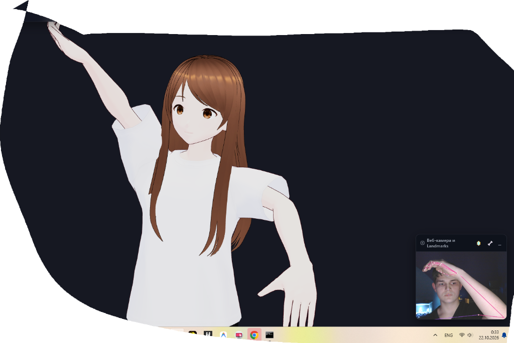

# VTuber Studio Pro ✨ (Web Edition)

<p align="center">
  <span>English Version</span> | <a href="README.md"><strong>Русская версия</strong></a>
</p>

<p align="center">
  
</p>

A standalone browser-based 3D virtual avatar (VTuber) studio with high-precision AI facial tracking (Apple ARKit 52 Perfect Sync), two-bone anatomical arm IK, finger tracking, and torso movement using a standard webcam!

---

## 🌟 How Does VTuber Studio Pro Compare to VSeeFace and Warudo?

| Feature | VTuber Studio Pro | VSeeFace / Warudo |
| :--- | :--- | :--- |
| **Installation** | **None** — runs directly in the browser or via a lightweight portable launcher | Requires heavy multi-gigabyte software installation (1.5GB to 5GB+) |
| **Platform** | **Cross-Platform** on any modern browser (Windows, macOS, Linux) | Primarily Windows desktop |
| **OBS Studio** | **Native Browser Source** (`http://localhost:5173/?obs=true`) with transparent canvas | Window Capture / Game Capture or virtual camera |
| **Privacy** | **100% Local** — runs on client GPU/CPU via WebAssembly & WebGL. No video ever leaves your device | Depends on software & connected plugins |
| **Cost** | **100% Free & Open Source (MIT)** | Free with limitations or paid DLC / subscription tiers |

---

## 🚀 Quick Start

### For Streamers & End-Users (1-Click, No Node.js)
1. Go to **[Releases](https://github.com/ydjdydjfbfuduxbxiehsjd-source/vtuber-studio/releases)** and download `VTuber_Studio_Pro.zip`.
2. Extract the archive to any folder.
3. Launch **`start.bat`** (Windows uses built-in PowerShell HTTP server; no software installation needed).
4. Browser automatically opens at `http://localhost:5173/`.

### For Developers (Build from Source)
Requires **[Node.js](https://nodejs.org/) (v18+)** and **npm**:
```bash
# 1. Clone repository
git clone https://github.com/ydjdydjfbfuduxbxiehsjd-source/vtuber-studio.git
cd vtuber-studio

# 2. Install dependencies
npm install

# 3. Start local development server with hot reload
npm run dev

# 4. Build production bundle to dist/
npm run build

# 5. Preview production build locally
npm run preview
```

---

## 🎀 Loading Custom VRM Avatars

1. **Drag & Drop**: Drag any `.vrm` file from your desktop/file manager directly into the browser window.
2. **Sidebar Upload**: Click on the upload zone in the left panel.
3. **Local Assets**: Place `.vrm` files into `public/models/`.

Supports both **VRM 0.x** and **VRM 1.0** specifications (VRoid Studio, Booth, Blender exports).

---

## 🎯 Arm Calibration & Reach Multiplier

1. Start webcam tracking via **"Start Camera"**.
2. Stand centered in front of your camera so your shoulders and arms are clearly visible.
3. Click **"Калибровка (T-поза)"** at the bottom of the sidebar.
4. Hold a T-pose during the 3-second countdown.
5. The system measures your shoulder width and arm span, sets your scale, and saves it in `localStorage`.
6. Adjust the **"Reach Multiplier"** slider (default: `1.15x`) to fine-tune how far the avatar arms reach.

---

## 🎥 OBS Studio Integration (Browser Source)

1. Turn on the **"Режим OBS (Прозрачный фон)"** toggle in the sidebar or press **`H`** to hide all UI elements.
2. In OBS Studio, add a new **Browser Source**:
   * **URL**: `http://localhost:5173/?obs=true`
   * **Width**: `1920`
   * **Height**: `1080`
   * Check **"Shutdown source when not visible"**.
3. The `?obs=true` parameter automatically enables transparent canvas rendering with all overlays hidden.

---

## ⚠️ Known Limitations (Honest Breakdown)

* **Monocular Webcam Depth**: Single webcam vision cannot measure true optical depth; Z-coordinates are heuristic and dampened (`0.4x`) to avoid jitter.
* **Frame Edges**: If a shoulder or elbow exits the camera frame, direction caching holds the pose before gently transitioning back to idle A-pose.
* **Lighting**: Good, even frontal facial lighting is required for accurate 52-blendshape ARKit tracking.
* **Hand Over Face**: If both hands completely cover the face, facial tracking will pause until the face is visible again.

---

## 🗺️ Roadmap

- [ ] **VMC (Virtual Motion Capture)** protocol streaming over WebSocket/UDP for Unity, Unreal Engine, and Blender.
- [ ] Animation recording and export to **BVH** and **glTF/GLB** formats.
- [ ] Customizable 3D environments (virtual rooms, dynamic studio lighting).
- [ ] Stream interactive gesture triggers (sound effects, props).

---

## ⌨️ Hotkeys

| Key | Action |
| :--- | :--- |
| **H** | Hide / Show UI panels (for OBS capture) |
| **D** | Toggle **Debug HUD** overlay and 3D IK wrist targets |
| **Space** | Center camera & reset avatar to resting pose |
| **LMB + Drag** | Orbit camera around avatar |
| **RMB + Drag** | Pan scene camera |
| **Mouse Wheel** | Zoom in / out |

---

## ⚖️ Licenses

* **Software Code**: [MIT License](LICENSE).
* **3D Models**: Sample model `sample.vrm` provided by pixiv Inc. under [VRM 1.0 License](https://vrm.dev/licenses/1.0/). User models remain under their respective creators' copyright.
