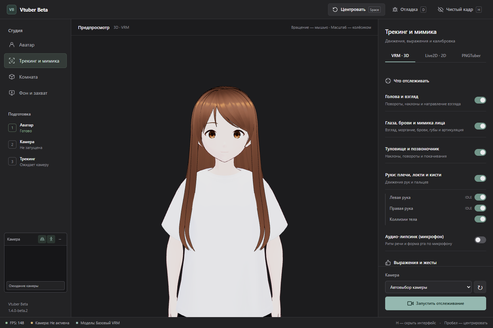

# Vtuber Beta

Студия для виртуальных аватаров: VRM, Live2D и PNGTuber в одном интерфейсе. Настройте персонажа, подключите камеру или микрофон и подготовьте кадр для стрима.

**Текущая версия — 1.4.0-beta.2.** [Описание обновления](https://github.com/ydjdydjfbfuduxbxiehsjd-source/vtuber-studio/releases/tag/v1.4.0-beta.2) · [Все релизы](https://github.com/ydjdydjfbfuduxbxiehsjd-source/vtuber-studio/releases)

## Скачать

| Версия | Готовая сборка | Что нужно для запуска |
| --- | --- | --- |
| **Desktop · Windows x64** | [Скачать ZIP · 219 МБ](https://github.com/ydjdydjfbfuduxbxiehsjd-source/vtuber-studio/releases/download/v1.4.0-beta.2/Vtuber-Beta-1.4.0-beta.2-Windows-x64.zip) | Распаковать и открыть `Vtuber Beta.exe`. Установка Node.js не нужна. |
| **Web · браузер** | [Скачать ZIP · 64 МБ](https://github.com/ydjdydjfbfuduxbxiehsjd-source/vtuber-studio/releases/download/v1.4.0-beta.2/Vtuber-Beta-1.4.0-beta.2-Web.zip) | Node.js 22+, Chrome или Edge. В комплекте готовый интерфейс и локальный сервер. |

Веб-версия запускается локально в браузере. Онлайн-демо по отдельной ссылке пока нет. Контрольные суммы архивов приложены к релизу.

## Три режима аватара

| Режим | Как работает |
| --- | --- |
| **VRM · 3D** | Импорт VRM 0 и VRM 1, трекинг лица, тела, рук и пальцев через камеру, мимика и аудиолипсинк. Возможности выражений зависят от модели. |
| **Live2D · 2D** | Импорт модели, настройка мимики, калибровка и управление выражениями. |
| **PNGTuber** | Работа без камеры: рот реагирует на микрофон, глаза моргают по таймеру. Громкая речь плавно увеличивает персонажа и может включать отдельный кадр крика. |

## Что ещё есть

- **Новый интерфейс студии.** Разделы аватара, трекинга, комнаты и захвата; большой предпросмотр в центре и настройки справа.
- **Комната для 3D-аватара.** Мебель, свет, ракурсы, посадка персонажа и импорт GLB.
- **Подготовка к стриму.** Настройки фона и чистый кадр для захвата в OBS. Клавиша **H** скрывает интерфейс.
- **Локальное сохранение.** Импортированные модели и PNG сохраняются между запусками. Данные веб-версии и desktop хранятся отдельно.

## Первый запуск

### Desktop

1. Скачайте Windows-архив и распакуйте **всю папку**.
2. Запустите `Vtuber Beta.exe`. Остальные файлы рядом с EXE нужны для работы.
3. Выберите VRM, Live2D или PNGTuber и добавьте свою модель либо картинки.
4. Включите камеру или микрофон в зависимости от выбранного режима.

Сборка не подписана цифровым сертификатом. Это тестовая версия для Windows x64.

### Web

1. Установите [Node.js 22 или новее](https://nodejs.org/) и распакуйте Web-архив.
2. В Windows откройте `start-web.cmd`. В macOS или Linux выполните `node server.cjs` из распакованной папки.
3. Откройте адрес из окна сервера в Chrome или Edge — обычно `http://localhost:5173/`.
4. Оставьте сервер запущенным на время работы и разрешите доступ к камере или микрофону, когда он понадобится.

Устанавливать npm-зависимости и собирать проект не требуется. Открывать `index.html` напрямую через `file://` не нужно.

## Эмоции по голосу — эксперимент

В PNGTuber можно обучить три коротких примера: обычную речь, сердитую подачу и смех. Приложение сравнивает текущий звук с ними и переключает соответствующие картинки.

Анализ работает локально; сохраняются числовые признаки, без аудиозаписей. Это экспериментальное сравнение, которое может ошибаться. Для злости и смеха пока используется по одному цельному кадру.

## Обратная связь

[Сообщить об ошибке или предложить улучшение](https://github.com/ydjdydjfbfuduxbxiehsjd-source/vtuber-studio/issues/new). Укажите версию, режим аватара и шаги, после которых появилась проблема.

Готовые актуальные сборки публикуются в **Releases**. В исходниках этого публичного репозитория также сохранена ранняя веб-версия; её файлы и старый архив в корне могут отличаться от текущего релиза.

Код распространяется по лицензии MIT. Права на модели, рисунки и сторонние компоненты регулируются их собственными лицензиями.
